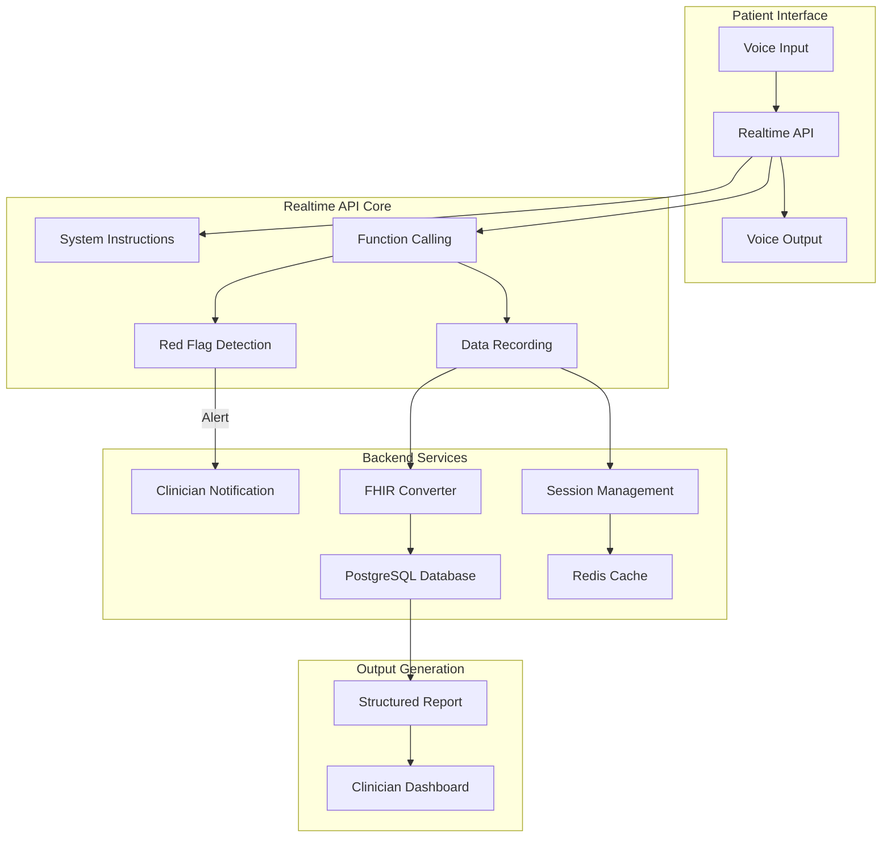

# Medical Intake Voice Agent - Final Architecture (Realtime API)
## Strict Information Collection with FHIR Compliance

## Executive Summary

This architecture implements a voice-based medical intake agent using OpenAI's Realtime API, designed to collect patient information with strict boundaries against providing medical advice, interpretation, or reassurance. All data is mapped to FHIR standards with immediate escalation of red-flag symptoms.

## Core Principles
- **Neutral Information Collector**: No medical advice, interpretation, or reassurance
- **FHIR Compliant**: All data mapped to standardized clinical formats
- **Safety First**: Immediate escalation of red-flag symptoms
- **Empathetic but Bounded**: Professional, caring tone without crossing medical boundaries
- **Real-time Interaction**: Sub-second latency for natural conversation flow

## System Architecture



## Technology Stack

### Core Voice Service
- **OpenAI Realtime API**: All-in-one speech-to-speech processing
- **WebRTC**: Real-time audio streaming
- **Latency**: ~320ms end-to-end

### Backend Services
- **Runtime**: Node.js + Express + TypeScript
- **Database**: PostgreSQL (local Docker)
- **Cache**: Redis (local Docker)
- **FHIR Mapping**: Custom TypeScript services

### Frontend
- **Framework**: React + TypeScript
- **UI**: Tailwind CSS
- **State Management**: Zustand
- **Audio Handling**: Web Audio API

## Key Components

### 1. Realtime API Configuration

```javascript
const realtimeConfig = {
  instructions: `You are a medical intake assistant that ONLY collects information.

CRITICAL RULES - NEVER VIOLATE:
1. NEVER provide medical advice, diagnosis, or treatment suggestions
2. NEVER interpret symptoms or test results  
3. NEVER offer reassurance about conditions
4. ONLY use these exact response patterns:
   - "What brings you in today?"
   - "When did [repeat their exact words] start?"
   - "I've recorded that you have [repeat their exact words]."
   - "Thank you for that information."

If patient asks medical questions:
- "Your provider will discuss this with you."
- "I'm here to collect information for your provider."

RED FLAGS requiring immediate escalation:
- Chest pain, difficulty breathing, severe bleeding
- Loss of consciousness, stroke symptoms
- Suicidal ideation`,

  voice: "nova",
  temperature: 0.1,
  max_response_length: 100,

  tools: [
    {
      name: "red_flag_detected",
      description: "Alert clinical team immediately",
      parameters: {
        symptoms: "array",
        severity: "string"
      }
    },
    {
      name: "save_response",
      description: "Save patient response to database",
      parameters: {
        question: "string",
        answer: "string",
        timestamp: "string"
      }
    },
    {
      name: "log_conversation",
      description: "Log all interactions for audit",
      parameters: {
        patient_said: "string",
        agent_said: "string"
      }
    }
  ]
};
```

### 2. Red Flag Detection System

```typescript
// Integrated directly into Realtime API instructions
// Triggers immediate function call when detected
const redFlagPatterns = [
  "chest pain",
  "can't breathe", 
  "difficulty breathing",
  "severe bleeding",
  "passed out",
  "unconscious",
  "stroke",
  "want to die",
  "suicidal"
];

// Function handler
async function handleRedFlag(params: RedFlagParams) {
  // 1. Immediately pause conversation
  // 2. Alert clinical team
  await notifyClinician({
    sessionId: params.sessionId,
    symptoms: params.symptoms,
    severity: params.severity,
    timestamp: new Date()
  });
  
  // 3. Log emergency event
  await logEmergencyEvent(params);
  
  // 4. Response to patient
  return "I've recorded this information. Please hold while I notify the clinical team.";
}
```

### 3. FHIR Resource Mapping

```typescript
// Real-time conversion of collected data to FHIR
function createFHIRBundle(sessionData: SessionData): Bundle {
  return {
    resourceType: "Bundle",
    type: "collection",
    entry: [
      {
        resource: createPatientResource(sessionData.demographics)
      },
      {
        resource: createConditionResource(sessionData.chiefComplaint)
      },
      ...sessionData.symptoms.map(s => ({
        resource: createObservationResource(s)
      })),
      ...sessionData.medications.map(m => ({
        resource: createMedicationStatementResource(m)
      }))
    ]
  };
}
```

### 4. Session State Management

```typescript
interface IntakeSession {
  id: string;
  patientId?: string;
  status: 'active' | 'paused' | 'completed' | 'escalated';
  startTime: Date;
  conversation: ConversationEntry[];
  fhirResources: any[];
  redFlags: RedFlag[];
}

// Managed in Redis for real-time performance
class SessionManager {
  async createSession(): Promise<IntakeSession> {
    const session: IntakeSession = {
      id: uuidv4(),
      status: 'active',
      startTime: new Date(),
      conversation: [],
      fhirResources: [],
      redFlags: []
    };
    
    await redis.setex(
      `session:${session.id}`,
      3600, // 1 hour TTL
      JSON.stringify(session)
    );
    
    return session;
  }
  
  async updateSession(id: string, updates: Partial<IntakeSession>) {
    const session = await this.getSession(id);
    const updated = { ...session, ...updates };
    await redis.setex(`session:${id}`, 3600, JSON.stringify(updated));
  }
}
```

### 5. Structured Intake Report

```typescript
function generateIntakeReport(session: IntakeSession): IntakeReport {
  return {
    header: {
      reportType: 'PATIENT INTAKE SUMMARY',
      sessionId: session.id,
      generatedAt: new Date(),
      duration: calculateDuration(session),
      redFlagsDetected: session.redFlags.length > 0
    },
    
    patient: extractPatientInfo(session),
    
    chiefComplaint: {
      description: session.chiefComplaint,
      onset: session.symptomOnset,
      severity: session.severity
    },
    
    symptoms: session.symptoms.map(s => ({
      name: s.name,
      description: s.description,
      duration: s.duration
    })),
    
    medicalHistory: {
      conditions: session.conditions || [],
      surgeries: session.surgeries || [],
      medications: session.medications || [],
      allergies: session.allergies || []
    },
    
    redFlags: session.redFlags.map(rf => ({
      symptoms: rf.symptoms,
      detectedAt: rf.timestamp,
      severity: rf.severity
    })),
    
    transcript: session.conversation
  };
}
```

## Security & Compliance

### Data Protection
- All patient data stored locally
- Audio streams encrypted with WebRTC
- Database encryption at rest
- Redis configured with password protection

### Audit Trail
```typescript
// Every interaction logged
interface AuditEntry {
  sessionId: string;
  timestamp: Date;
  eventType: 'conversation' | 'red_flag' | 'data_access';
  userId?: string;
  details: any;
}
```

### HIPAA Considerations
- Minimum necessary data collection
- Audit logs for all access
- Encrypted storage and transmission
- Regular security assessments

## Local Deployment Architecture

```
┌─────────────────────────────────────────────────────────┐
│                   Local Machine                          │
├─────────────────────────────────────────────────────────┤
│                                                          │
│  ┌─────────────────┐         ┌──────────────────────┐  │
│  │   Browser       │         │   Backend Services   │  │
│  │                 │ WebRTC  │                      │  │
│  │  React App     │ ◄──────► │  Node.js + Express  │  │
│  │  (Port 5173)   │         │  (Port 3000)        │  │
│  └────────┬────────┘         └──────────┬───────────┘  │
│           │                              │              │
│           ▼                              ▼              │
│  ┌──────────────────┐         ┌──────────────────┐   │
│  │ OpenAI Realtime  │         │   Local Docker    │   │
│  │      API         │         │                   │   │
│  └──────────────────┘         │  ┌─────────────┐ │   │
│                               │  │ PostgreSQL  │ │   │
│                               │  │ (Port 5432) │ │   │
│                               │  └─────────────┘ │   │
│                               │                   │   │
│                               │  ┌─────────────┐ │   │
│                               │  │    Redis    │ │   │
│                               │  │ (Port 6379) │ │   │
│                               │  └─────────────┘ │   │
│                               └───────────────────┘   │
│                                                        │
└────────────────────────────────────────────────────────┘
```

## Performance Characteristics

- **Voice Latency**: ~320ms (10x faster than traditional)
- **Red Flag Detection**: <100ms
- **FHIR Conversion**: <50ms
- **Database Write**: <20ms
- **Total Response Time**: <500ms

## Success Metrics

- **Completion Rate**: % of intakes completed
- **Average Duration**: Target <10 minutes
- **Red Flag Response Time**: <5 seconds to clinician alert
- **Boundary Compliance**: 100% (no medical advice given)
- **Data Completeness**: 95%+ required fields collected
- **System Uptime**: 99.9% availability

## Implementation Phases

### Phase 1: Core POC 
- Realtime API integration
- Basic conversation flow
- Red flag detection
- Local database setup

### Phase 2: FHIR & Reporting 
- FHIR resource mapping
- Structured report generation
- Clinician dashboard
- Audit logging

### Phase 3: Testing & Refinement 
- Boundary compliance testing (1000+ scenarios)
- Performance optimization
- Error handling improvements
- Documentation completion

## Key Design Decisions

1. **Realtime API** chosen for superior user experience despite higher cost
2. **Instruction-based boundaries** with extensive testing to ensure compliance
3. **Local deployment** for data privacy during POC
4. **FHIR from the start** to ensure healthcare interoperability
5. **Redis for session state** to handle real-time conversation needs
